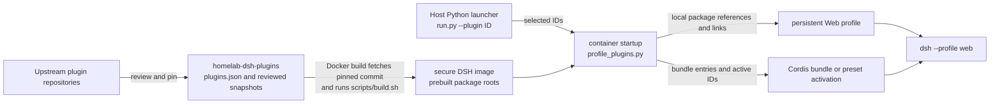

# Homelab DSH plugins

This repository stores reviewed plugin package snapshots for [homelab-deepseek-harness-secure](https://github.com/recrack/homelab-deepseek-harness-secure). It owns the upstream revision records, local hardening, package build steps, and applicable notices. The secure repository owns image construction, the supported plugin ID list, persistent profile activation, and the runtime network policy.

The secure image fetches one pinned commit of this repository and builds its packages during the Docker image build. At launch, `--plugin <id>` selects packages already in the image and adds them to the persistent Web profile. The launcher does not clone plugin sources at runtime. New state directories select no optional plugins by default; existing selections persist. See the secure deployment's [plugin build and activation architecture](https://github.com/recrack/homelab-deepseek-harness-secure/blob/master/deploy/offline/README.md#build-and-activation).

## Catalog

| ID | Package | Source | Snapshot | Activation |
| --- | --- | --- | --- | --- |
| `dsh-browser` | `@zseven-w/dsh-browser` | [ZSeven-W/dsh-browser](https://github.com/ZSeven-W/dsh-browser) | `69fa75ac53c36c7f297fcce5ed2595fee62e068c` | Web presets |
| `dsh-crew` | `@zseven-w/dsh-crew` | [ZSeven-W/dsh-crew](https://github.com/ZSeven-W/dsh-crew) | `b00cc6d039cdecf8563b8863aa4b5404285f6e83` | Web bundle |
| `dsh-context` | `dsh-context` | [bowenliang123/dsh-context](https://github.com/bowenliang123/dsh-context) | `0.83.0` plus the local offline patch | Web bundle |
| `dsh-claude-artifacts` | `dsh-claude-artifacts` | [JimLiu/baoyu-design](https://github.com/JimLiu/baoyu-design) | `2.12.1` | Web bundle |
| `dsh-claude-design` | `dsh-claude-design` | [JimLiu/baoyu-design](https://github.com/JimLiu/baoyu-design) | `2.12.1` | Web bundle |

`plugins.json` records package paths, upstream revisions, and activation types. Each package retains its applicable upstream license and notices. The `dsh-context` snapshot blocks its automatic catalog, balance, and recommendation requests; its upstream source is retained under `packages/dsh-context/upstream/package` for comparison.

## How the secure deployment uses these packages

| Stage | Owner | Behavior |
| --- | --- | --- |
| Snapshot | This repository | Stores reviewed package code, upstream pins, and local hardening. |
| Image build | `homelab-deepseek-harness-secure` | Fetches a pinned commit and builds or stages the packages inside the Docker image. |
| Runtime selection | `homelab-deepseek-harness-secure` | The Python launcher accepts explicit IDs and records selected local packages in the persistent Web profile. The Plugin Manager UI and tool are disabled. |
| Activation | DSH Cordis profile | Bundle entries join the profile's bundle list; `dsh-browser` is added to shipped Web presets. Selected code runs in the DSH container and follows its network policy. |



Adding an entry to `plugins.json` alone does not make a plugin selectable. A new package also needs image-build and runtime profile wiring in the secure repository. Every supported ID must be added to its validation and profile configuration; preset-based plugins also need a preset row. The linked [architecture guide](https://github.com/recrack/homelab-deepseek-harness-secure/blob/master/deploy/offline/README.md#build-and-activation) names those owners.

## Build

The secure image runs this script from its pinned checkout:

```sh
scripts/build.sh
```

This builds `dsh-browser`, installs the production dependencies for `dsh-crew`, and installs the production dependency for `dsh-context`. The Baoyu package snapshots include their built `lib` files.
